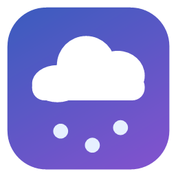
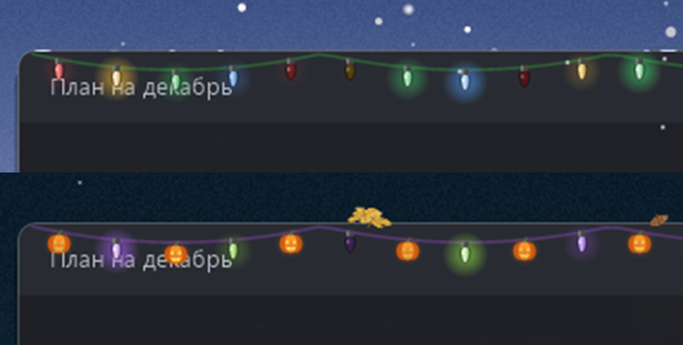

# DeskWeather — погода на рабочем столе Windows

Анимированная погода поверх всех окон: снег копится сугробами на окнах и панели задач,
листья разлетаются от курсора, метеоры разбиваются об окна на искры. Клики всегда
проходят сквозь эффекты.

## Скачать

**[DeskWeather-Setup.exe](https://github.com/DeskWeather/DeskWeather/releases/latest/download/DeskWeather-Setup.exe)** — последняя версия.
Все версии и списки изменений — на странице [Releases](https://github.com/DeskWeather/DeskWeather/releases).
Полная версия — [ключ на Plati](https://plati.market/itm/deskweather-full-version-key-live-weather-on-your-windows-desktop/6399572).

Установщик ставит программу только для текущего пользователя и не просит прав администратора.
Если Windows пишет «Windows защитила ваш компьютер», нажмите «Подробнее» → «Выполнить в любом случае»:
так SmartScreen встречает программы, которые ещё мало кто скачивал.

**Требования:** Windows 10 или 11 и .NET Framework 4.8 (уже есть в любой актуальной Windows).

## Что умеет

* **Эффекты:** снег, дождь с молниями, сакура, листья, светлячки, звездопад.
* **Снег можно лепить:** скатайте ком из сугроба, поставьте три кома друг на друга — получится снеговик в шляпе и шарфе.
* **Санта-Клаус** пролетает над экраном на санях с оленями; можно добавить своих персонажей из картинок.
* **Обои:** нарисованные программой сцены, в том числе лес в четыре времени года, и свои фото — на все мониторы или на каждый отдельно.
* **Виджеты:** часы с датой в нескольких стилях (от рождественского до Хэллоуина) и мини-плеер.
* **Гирлянда на окнах:** новогодняя или хэллоуинская, мерцает на заголовках открытых окон.
* **Панель задач:** прозрачная или минималистичная, с автоскрытием.

В играх и полноэкранном видео DeskWeather ставит себя на паузу, а на батарее рисует вдвое меньше частиц.

## Бесплатно и полная версия

Снег и дождь работают бесплатно. Остальные эффекты, обои, виджеты и украшения открывает ключ полной версии.

**[Купить ключ на Plati](https://plati.market/itm/deskweather-full-version-key-live-weather-on-your-windows-desktop/6399572)** — оплата разовая, без подписки.

Ключ вводится в окне настроек по кнопке «Полная версия…». Программа не выходит в интернет: ключ проверяется прямо на компьютере.

## Удаление

«Параметры → Приложения → DeskWeather → Удалить». Можно удалить вместе с настройками или оставить их.
